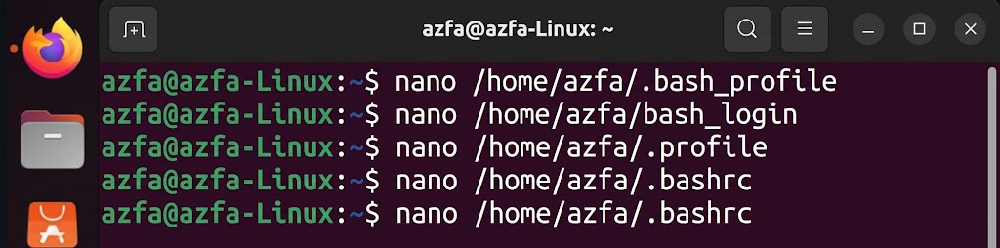

### 1. Manipulasi History Shell (HISTSIZE & Command History)

### 2. Manajemen Proses (Foreground, Background, & Jobs)

### 3. Modifikasi File Profile User (.bash_profile)

### 4. Pemeriksaan File Konfigurasi Shell (bash_login, profile, bashrc)

### 5. Modifikasi Profile Global (/etc/profile)

### 6. Pembuatan Script Bash & Konfigurasi Hak Akses (chmod)

### 7. Konfigurasi Logout (.bash_logout) & Prompt String (PS1)

